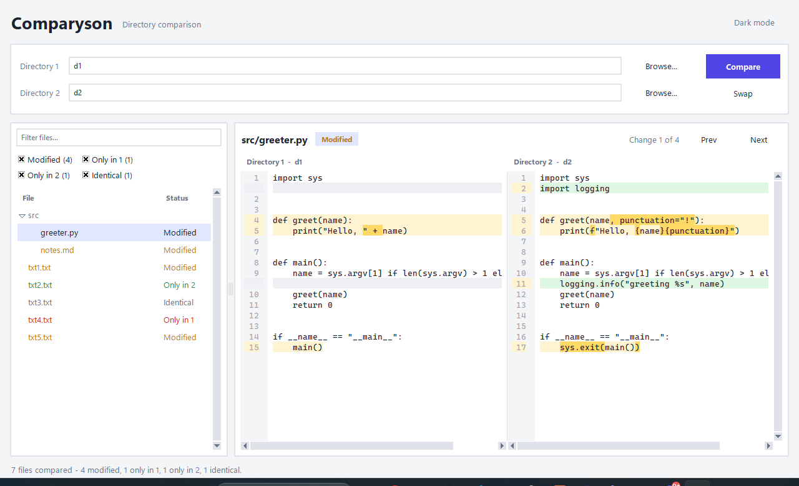

# Comparyson

A desktop app for comparing two directories and inspecting file differences side by side.



## Features

- Recursive directory comparison (identical, modified, only in one side)
- Side-by-side diff with line numbers, synced scrolling and intra-line highlights
- Jump between changes (Prev / Next, or Ctrl+Up / Ctrl+Down)
- File tree with status filters and search
- Light and dark themes; binary and oversized files handled gracefully

## Run

Requires Python 3.9+ with Tkinter (bundled with the standard installers). No other dependencies.

```
python app.py                 # pick directories in the UI
python app.py d1 d2           # or pass them on the command line
```

Press F5 to re-run a comparison. `d1/` and `d2/` hold sample data to try it out.

## Tests

```
python -m unittest discover tests
```
